# Mermaid 回归样例

用于验证 v0.0.1 的编辑预览、主题切换及 HTML、PDF、打印输出。预期前 12 个代码块正常显示，最后一个代码块显示错误占位且不阻断其他图表；修正错误代码后应恢复显示。

## 流程图与中文标签

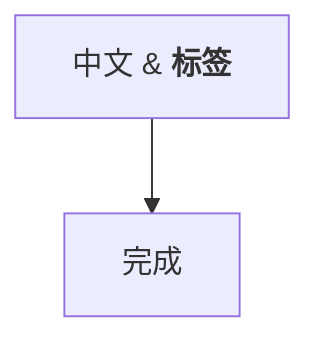

## 时序图

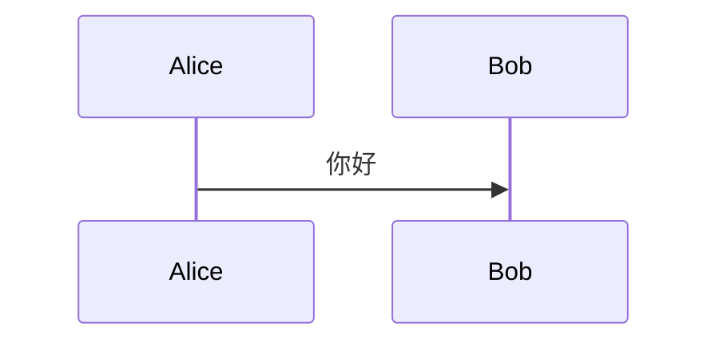

## 类图

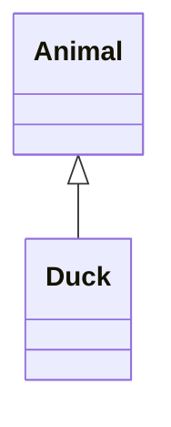

## 状态图

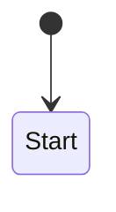

## 实体关系图

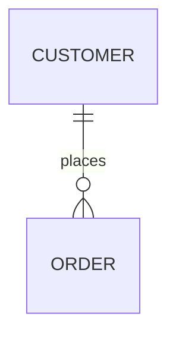

## 甘特图

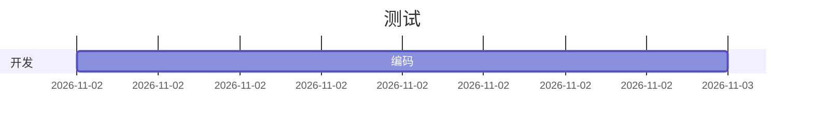

## 饼图

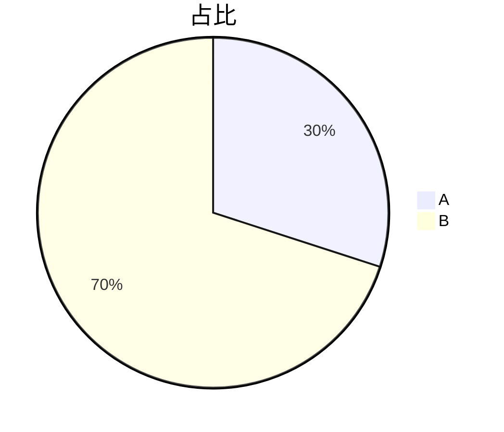

## 思维导图

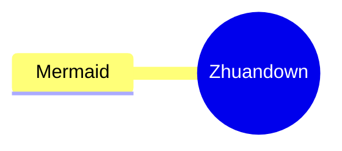

## 时间线

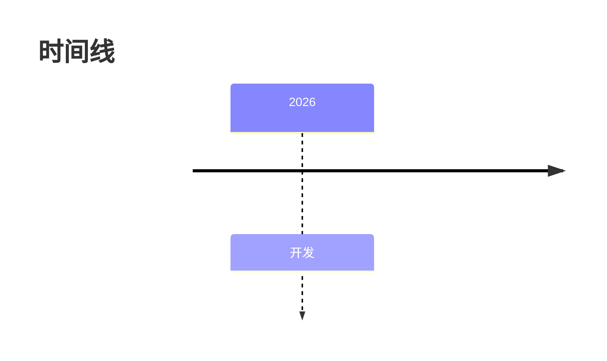

## XY 图

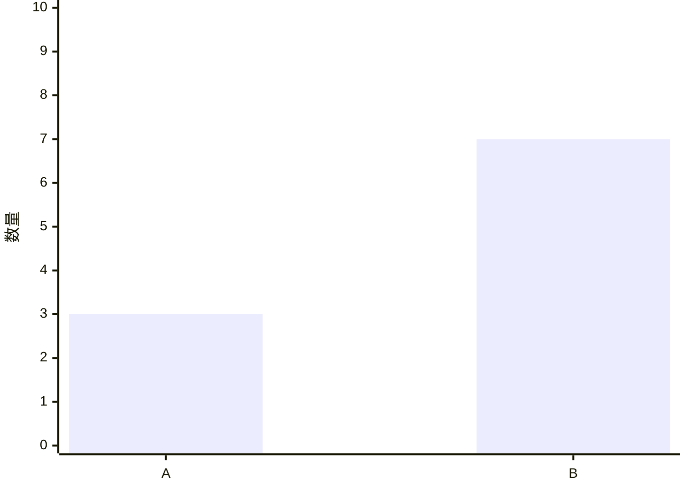

## 块图

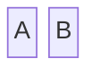

## 架构图

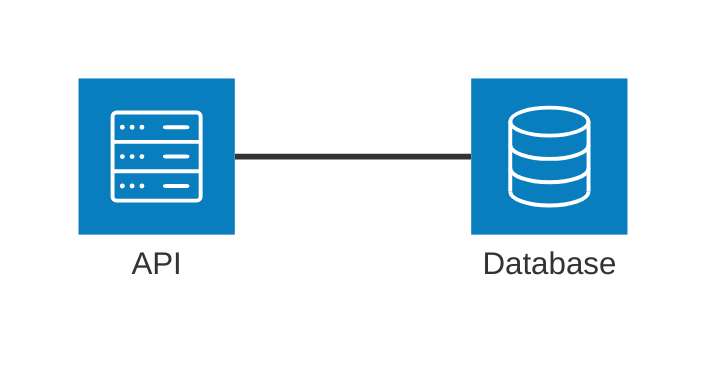

## 错误恢复

下方代码故意无效。将内容替换为 `graph TD; A-->B` 后应恢复显示。

```mermaid
invalid
```
